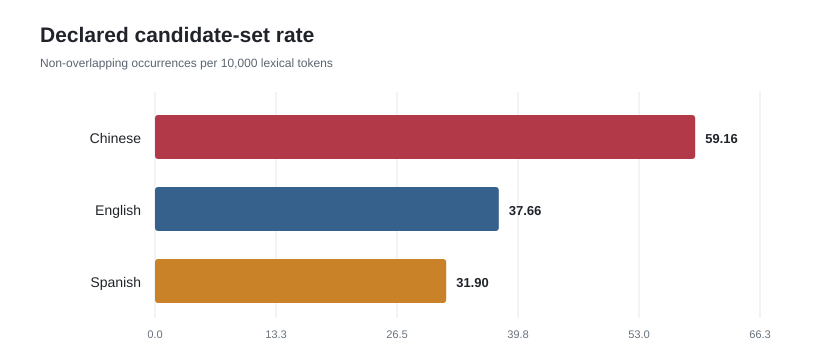
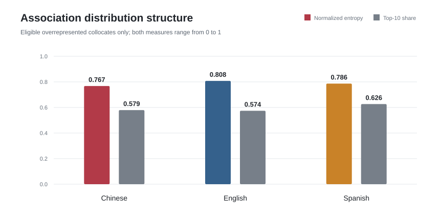
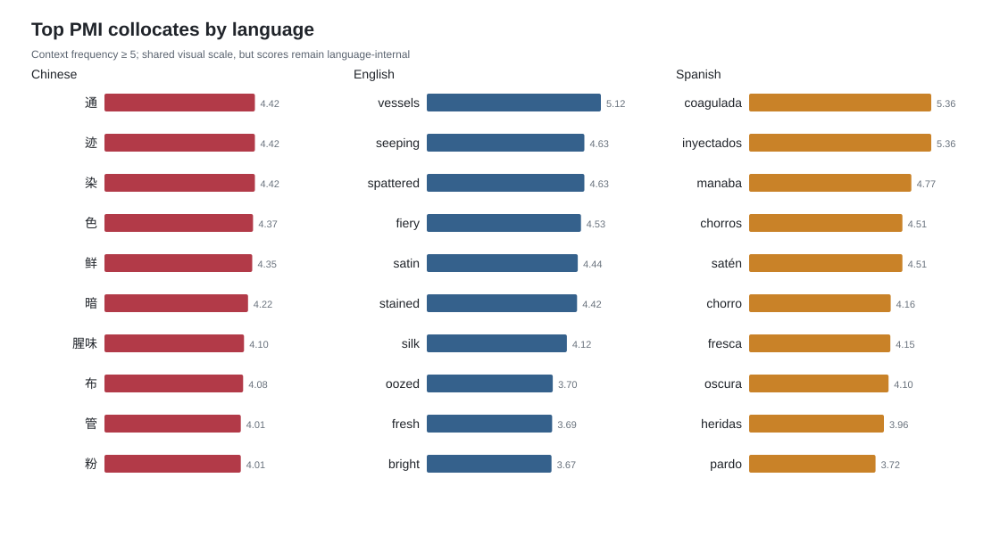
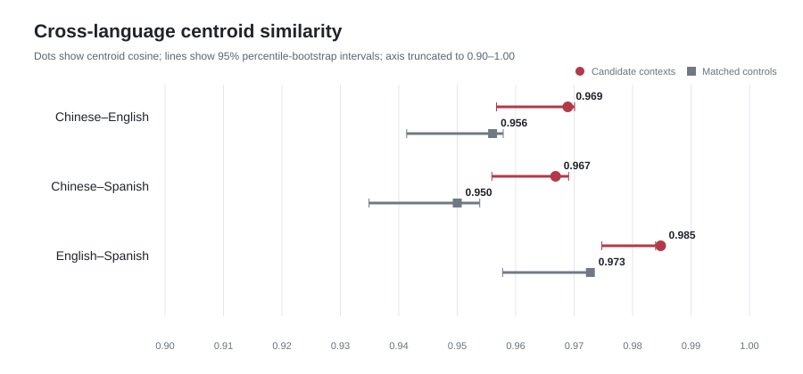
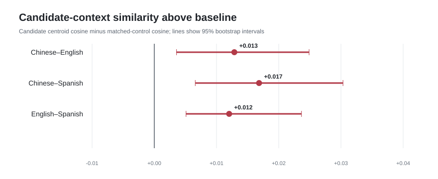

# A Corpus-based and Computational Analysis of Red-related Lexical and Contextual Variation in Chinese–English–Spanish Translation

## The representation of red in *Red Sorghum*

## Abstract

This portfolio study examines how a declared set of red-related lexical items is represented in the Chinese, English, and Spanish versions of *Red Sorghum*. It combines corpus auditing, reproducible sentence preprocessing, ±5-token collocation statistics, structural comparison, and multilingual sentence embeddings. The validated literary-text slices share five parts with 9/11/9/9/10 subsections. Collocation strength is measured with frequency, PMI, and signed log-likelihood, while semantic context is represented with 384-dimensional multilingual MiniLM embeddings. Candidate-bearing sentences are compared with same-language, length-matched non-candidate controls, and uncertainty is estimated through 500 bootstrap iterations. The declared candidates occur at 59.16, 37.66, and 31.90 non-overlapping instances per 10,000 tokens in Chinese, English, and Spanish respectively, but these rates are not direct translation-equivalence measures. Candidate-context centroids are highly similar across languages (cosine 0.967–0.985) and exceed matched baselines by only 0.012–0.017. The results support a cautious claim of modest cross-language concentration in red-related contexts, while lexical differences, candidate design, tokenization, and the shared narrative remain important alternative explanations. Corpus evidence and interpretation are kept explicitly separate throughout.

## 1. Research questions

1. How frequent are the declared red-related candidates in each validated text?
2. Which lexical items are statistically associated with those candidates within each language?
3. How do the distributional structures of these association profiles differ across languages?
4. Are candidate-bearing sentence contexts more similar across languages than length-matched non-candidate contexts from the same novels?

## 2. Data and scope

Only the three researcher-supplied complete novel files are used as corpus data. The raw files decode under strict UTF-8 rules and are preserved unchanged. Ebook metadata, contents pages, copyright matter, and author biographies are excluded through documented boundary markers; shared literary dedications remain. Structural validation found the same five-part organization and subsection pattern in all three retained texts.

|Language|Analysis tokens|Phase 2 sentences|Declared candidate set|
|---|---:|---:|---|
|Chinese|123853|8176|红, 血, 鲜红, 赤, 血红|
|English|133569|8812|red, blood, bloody, crimson, scarlet|
|Spanish|167104|9491|rojo, roja, rojos, rojas, sangre|

The candidate sets are operational definitions, not claims of exact lexical equivalence. Chinese strings overlap, while Spanish includes grammatical gender and number forms. Phase 3 therefore uses non-overlapping longest-match targets.

## 3. Methods

### 3.1 Audit and preprocessing

Phase 1 records encoding, hashes, corpus size, provisional sentence counts, structural boundaries, and observed candidate frequencies. Phase 2 creates deterministic sentence records containing stable IDs, paragraph IDs, normalized analysis text, exact raw substrings, and complete-file character offsets. All retained non-whitespace characters are covered, and serialized offsets were independently verified.

### 3.2 Collocation analysis

Candidate contexts are measured within symmetrical ±5 lexical-token windows bounded by sentence boundaries. Overlapping windows are merged into unique token positions. PMI represents association strength; signed G² log-likelihood represents salience and direction relative to the remainder of the same-language corpus. Ranked results require at least five context occurrences. Raw scores are interpreted within languages because Chinese and Latin-script tokenization are not identical measurement systems.

### 3.3 Multilingual semantic analysis

Candidate-bearing sentences are encoded with `sentence-transformers/paraphrase-multilingual-MiniLM-L12-v2` through FastEmbed 0.8.0 using mean pooling and explicit L2 normalization. One non-candidate sentence is greedily matched to each candidate sentence on normalized character length. Cross-language comparisons use normalized group centroids. Percentile intervals are estimated with 500 bootstrap resamples using seed 42.

## 4. Results

### 4.1 Candidate frequency and association structure

Non-overlapping target rates are 59.16, 37.66, and 31.90 per 10,000 tokens for Chinese, English, and Spanish. These differences describe the declared candidate sets; they do not by themselves show semantic loss or gain.

Eligible positive association profiles contain 105 Chinese, 89 English, and 84 Spanish collocates. Their normalized entropy values are 0.767, 0.808, and 0.786. The profiles are therefore broadly distributed rather than dominated by one collocate, although Spanish has the largest top-ten frequency share (0.626).

The highest-PMI lists contain observable bodily-fluid, visual-intensity, and material-context vocabulary: Chinese includes 色, 鲜, 暗, 腥味, and 紫; English includes vessels, seeping, spattered, stained, fresh, bright, silk, and satin; Spanish includes coagulada, manaba, chorros, fresca, oscura, heridas, seda, and satén. This is an exploratory description of the ranked words, not a manually validated semantic taxonomy. Chinese one-character collocates may also be compound fragments and require concordance checking.

### 4.2 Multilingual sentence-context similarity

|Language pair|Candidate cosine|Distance|Control cosine|Candidate − control|Delta 95% CI|
|---|---:|---:|---:|---:|---|
|Chinese–English|0.969|0.031|0.956|+0.013|[0.004, 0.025]|
|Chinese–Spanish|0.967|0.033|0.950|+0.017|[0.007, 0.030]|
|English–Spanish|0.985|0.015|0.973|+0.012|[0.005, 0.024]|

All three candidate-context comparisons exceed their matched baselines by a small amount, and all three bootstrap delta intervals remain above zero. The strongest candidate centroid similarity is English–Spanish; the largest baseline-adjusted difference is Chinese–Spanish. These are corpus-level centroid observations, not sentence alignments or evaluations of translation quality.

## 5. Discussion

The lexical and embedding results answer different questions. Collocation tables show which forms occur near the declared candidates inside each language. The embedding comparison shows whether the overall sentence contexts containing those candidates occupy similar multilingual vector regions. High raw centroid similarity is expected in part because all three texts share a narrative. The matched baseline is therefore crucial: after accounting for general same-novel similarity, candidate contexts retain a modest positive difference of approximately one to two cosine points.

The safest conclusion is that red-related contexts show measurable cross-language concentration alongside language-specific lexical realization. This does not establish a unidirectional cultural semantic shift. A stronger shift claim would require reliable sentence or passage alignment, manual semantic annotation, and sensitivity analysis using narrower and alternative candidate sets.

## 6. Limitations

- The study contains one novel and cannot support population-level claims about Chinese, English, or Spanish translation generally.
- Candidate sets differ in morphology and include blood-related terms as well as color terms; frequency totals are therefore not direct equivalents.
- Chinese candidate substrings overlap, and target-preserving segmentation can create one-character compound fragments.
- Sentence segmentation is deterministic rather than manually gold-annotated.
- The translations are not aligned at sentence level; centroid and nearest-neighbor analyses are exploratory.
- Multilingual MiniLM is a pretrained, quantized model with its own training-domain and cross-language biases.
- The bootstrap measures sampling variability within this corpus, not uncertainty about candidate design or model choice.
- No independent human annotation or inter-annotator agreement is included.

## 7. Reproducibility and research integrity

All thresholds, candidate forms, corpus boundaries, model settings, random seeds, and software dependencies are stored in versioned configuration or requirements files. Each phase writes machine-readable intermediate summaries. `run_pipeline.py` runs any consecutive phase range, while `verify_project.py` checks cross-phase invariants. Aggregate results and figures can be shared; copyrighted novels, sentence excerpts, embeddings, and nearest-neighbor tables remain excluded from Git.

Observed corpus measurements, exploratory interpretation, and unsupported claims are explicitly separated. No cultural meaning is inferred solely from frequency, PMI, or cosine similarity.

## 8. References

- Dunning, T. (1993). Accurate methods for the statistics of surprise and coincidence. *Computational Linguistics, 19*(1), 61–74.
- Church, K. W., & Hanks, P. (1990). Word association norms, mutual information, and lexicography. *Computational Linguistics, 16*(1), 22–29.
- Reimers, N., & Gurevych, I. (2019). Sentence-BERT: Sentence embeddings using Siamese BERT-networks. *EMNLP-IJCNLP*.
- Sentence Transformers. `paraphrase-multilingual-MiniLM-L12-v2` model card: https://huggingface.co/sentence-transformers/paraphrase-multilingual-MiniLM-L12-v2
- Qdrant. FastEmbed documentation: https://qdrant.github.io/fastembed/
